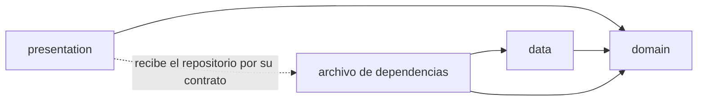
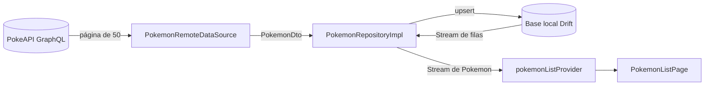
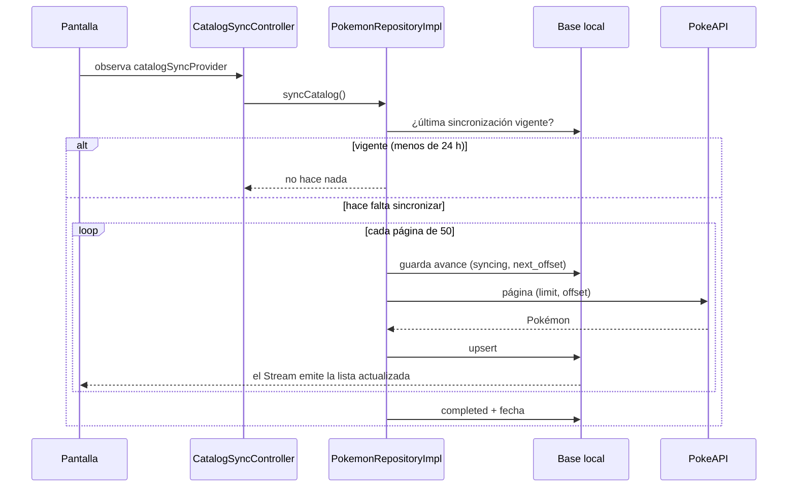

# Pokédex Flutter Offline-First

Proyecto final de **Desarrollo de Aplicaciones Móviles** (PUCMM): una Pokédex
hecha con Flutter que obtiene el catálogo de la API GraphQL de
[PokeAPI](https://pokeapi.co/docs/graphql), lo guarda en una base de datos
local y sigue funcionando sin conexión.

Este documento describe el **avance del proyecto**: estructura, persistencia,
integración con GraphQL y funcionamiento offline.

## Contenido

1. [Qué incluye el avance](#qué-incluye-el-avance)
2. [Cómo ejecutar](#cómo-ejecutar)
3. [Arquitectura](#arquitectura)
4. [Modelo de datos local](#modelo-de-datos-local)
5. [Estrategia de sincronización](#estrategia-de-sincronización)
6. [Funcionamiento offline](#funcionamiento-offline)
7. [Indicador de conectividad](#indicador-de-conectividad)
8. [Pruebas](#pruebas)
9. [Decisiones de arquitectura (ADR)](#decisiones-de-arquitectura-adr)
10. [Pendiente para la entrega final](#pendiente-para-la-entrega-final)

## Qué incluye el avance

| # | Entregable | Dónde está |
|---|---|---|
| 1 | Estructura por funcionalidades con capas `presentation`, `domain` y `data` | [`lib/features/`](lib/features) |
| 2 | Modelo de datos local: catálogo, favoritos y metadatos de sincronización | [`lib/core/database/`](lib/core/database) |
| 3 | Integración GraphQL con paginación, guardado local y sin duplicados | [`data/remote/`](lib/features/pokemon/data/remote), [`pokemon_repository_impl.dart`](lib/features/pokemon/data/repositories/pokemon_repository_impl.dart) |
| 4 | La interfaz observa la base local, no las respuestas de GraphQL | [`pokemon_catalog_providers.dart`](lib/features/pokemon/presentation/providers/pokemon_catalog_providers.dart) |
| 5 | Interfaz sin bloqueos: abre de inmediato y carga en segundo plano | [`main.dart`](lib/main.dart), [`pokemon_list_page.dart`](lib/features/pokemon/presentation/pages/pokemon_list_page.dart) |
| 6 | Catálogo con nombre, número, imagen y tipos; estados de carga, vacío y error con «Reintentar» | [`presentation/`](lib/features/pokemon/presentation) |
| 7 | Catálogo disponible sin conexión, también tras reiniciar | Base local + caché de imágenes |
| 8 | Indicador global Online / Offline con texto e icono | [`lib/features/connectivity/`](lib/features/connectivity), [`app.dart`](lib/app/app.dart) |
| 9 | Documentación: este README y los ADR | [`docs/adr/`](docs/adr) |

## Cómo ejecutar

Requisitos: **Flutter 3.44** (Dart 3.12) y un emulador o dispositivo Android o
iOS.

```bash
flutter pub get
```

```bash
flutter run
```

Comandos útiles:

| Comando | Para qué |
|---|---|
| `flutter analyze` | Revisar el código con el analizador estático |
| `flutter test` | Ejecutar todas las pruebas |
| `dart format lib test` | Dar formato al código |
| `dart run build_runner build` | Regenerar `app_database.g.dart` después de cambiar una tabla |

## Arquitectura

### Organización por funcionalidades

Cada funcionalidad (*feature*) tiene su propia carpeta con las tres capas. Lo
que comparten todas vive en `core`.

```
lib/
├── main.dart                      Punto de entrada
├── app/
│   └── app.dart                   MaterialApp, tema e indicador global
├── core/                          Compartido por todas las funcionalidades
│   ├── database/                  Base local (Drift): tablas y provider
│   ├── error/                     Errores tipados (Failure)
│   └── network/                   Cliente GraphQL
└── features/
    ├── pokemon/                   Catálogo de Pokémon
    │   ├── pokemon_dependencies.dart   Inyección de dependencias
    │   ├── domain/
    │   │   ├── entities/               Pokemon
    │   │   └── repositories/           PokemonRepository (contrato)
    │   ├── data/
    │   │   ├── local/                  Acceso a Drift
    │   │   ├── remote/                 Consulta GraphQL, DTO y acceso a PokeAPI
    │   │   ├── mappers/                Conversión DTO ↔ fila ↔ entidad
    │   │   ├── sync/                   Evita sincronizaciones simultáneas
    │   │   └── repositories/           PokemonRepositoryImpl
    │   └── presentation/
    │       ├── providers/              Estado de la pantalla (Riverpod)
    │       ├── pages/                  Pantalla del catálogo
    │       └── widgets/                Fila, imagen, etiqueta de tipo, mensajes
    └── connectivity/              Indicador Online / Offline
        ├── connectivity_dependencies.dart
        ├── domain/                     ConnectivityStatus y contrato
        ├── data/                       Implementación con connectivity_plus
        └── presentation/               Provider y widget del indicador
```

### Las tres capas

| Capa | Responsabilidad | Puede depender de |
|---|---|---|
| `domain` | Entidades y contratos de los repositorios. Dart puro. | Nada |
| `data` | Implementa los contratos: base local, API remota, DTO y mappers. | `domain`, `core` |
| `presentation` | Widgets y estado de la pantalla. | `domain`, `core` |



- `presentation` **no importa** nada de `data`, ni de GraphQL, ni de Drift.
  Recibe el repositorio por su contrato (`PokemonRepository`).
- El archivo `*_dependencies.dart` de cada funcionalidad es el único que conoce
  las clases concretas de `data`: crea la implementación y la entrega como
  contrato mediante un provider de Riverpod.
- Estas reglas se comprueban automáticamente en
  [`test/architecture_test.dart`](test/architecture_test.dart).

### Flujo de datos

La interfaz nunca recibe la respuesta de la red. La red escribe en la base
local y la interfaz observa la base:



La pantalla observa dos providers distintos:

| Provider | Qué contiene | Para qué lo usa la pantalla |
|---|---|---|
| `pokemonListProvider` | Los Pokémon guardados en la base local | Pintar la lista |
| `catalogSyncProvider` | El estado de la sincronización (en curso, error, terminada) | Barra de progreso, mensaje de error y «Reintentar» |

### Tecnologías

| Paquete | Uso |
|---|---|
| `drift` + `drift_flutter` | Base de datos local SQLite con consultas reactivas |
| `flutter_riverpod` | Manejo de estado e inyección de dependencias |
| `graphql` | Cliente GraphQL para PokeAPI |
| `connectivity_plus` | Estado de la red del dispositivo |
| `cached_network_image` | Imágenes con caché en disco |

## Modelo de datos local

Base SQLite (`pokedex.sqlite`) definida con Drift en
[`lib/core/database/`](lib/core/database).

| Tabla | Columnas | Llave primaria | Uso |
|---|---|---|---|
| `pokemon_table` | `id`, `dex_number`, `name`, `types`, `image_url`, `updated_at` | `id` | Catálogo descargado |
| `favorite_table` | `pokemon_id`, `created_at` | `pokemon_id` | Favoritos del usuario |
| `sync_metadata_table` | `resource_key`, `status`, `next_offset`, `last_success_at` | `resource_key` | Estado de cada sincronización |

- **Sin duplicados:** el `id` de PokeAPI es la llave primaria y se guarda con
  *upsert* (`insertAllOnConflictUpdate`): si el Pokémon ya existe, se actualiza.
- `types` guarda los tipos en orden, separados por coma (`grass,poison`).
- `status` es el enum `SyncStatus` (`syncing`, `completed`, `failed`).

## Estrategia de sincronización

Resumen de la estrategia elegida (el detalle y las alternativas están en el
[ADR 0002](docs/adr/0002-estrategia-de-sincronizacion-del-catalogo.md)):

1. **La base local manda.** La interfaz siempre muestra lo que hay guardado.
2. **Descarga completa y paginada.** Se pide el catálogo en páginas de 50
   (`limit` / `offset`) y cada página se guarda en cuanto llega, así la lista
   crece mientras se descarga.
3. **Solo cuando hace falta.** Al abrir la app se sincroniza si nunca se
   completó una descarga o si la última tiene más de 24 horas. El usuario puede
   forzarla con «Reintentar» o deslizando la lista hacia abajo.
4. **Reanudable.** Antes de cada página se guarda el avance (`next_offset`). Si
   la descarga se corta, el siguiente intento continúa donde se quedó.
5. **Los errores no borran datos.** Si falla, se registra `failed`, lo ya
   guardado se conserva y se muestra el mensaje con «Reintentar».
6. **Una a la vez.** `SyncCoordinator` evita dos descargas simultáneas.



Los errores técnicos se traducen a un `Failure` con un mensaje para el usuario
([`failures.dart`](lib/core/error/failures.dart)):

| Situación | Failure |
|---|---|
| El dispositivo no pudo conectarse | `NetworkFailure` |
| El servidor no respondió en 10 segundos | `TimeoutFailure` |
| HTTP 429 | `RateLimitFailure` |
| Otro error HTTP, respuesta ilegible o error de GraphQL | `ServerFailure` |

## Funcionamiento offline

- **Datos:** el catálogo se lee del archivo SQLite del dispositivo, por lo que
  está disponible sin conexión y después de cerrar y abrir la app.
- **Imágenes:** `cached_network_image` guarda cada imagen en el disco la
  primera vez que se muestra. Sin conexión se ven las que ya se habían
  mostrado; las demás muestran un icono.
- **Sin errores innecesarios:** si los datos están vigentes, al abrir la app
  sin conexión ni siquiera se intenta usar la red.

Cómo comprobarlo a mano:

1. Abrir la app con conexión y esperar a que termine la barra de progreso.
2. Activar el modo avión: la lista sigue visible y el indicador pasa a
   «Sin conexión».
3. Cerrar la app por completo y abrirla de nuevo, todavía sin conexión: el
   catálogo aparece igual.

## Indicador de conectividad

Franja en la parte inferior, visible en todas las pantallas, con icono y texto:

| Estado | Texto | Icono |
|---|---|---|
| Online | «En línea» | `Icons.wifi` |
| Offline | «Sin conexión» | `Icons.wifi_off` |

Durante el instante inicial, antes de conocer el estado de la red, muestra
«Comprobando conexión…».

- Es **global** porque se coloca una sola vez en `MaterialApp.builder`
  ([`app.dart`](lib/app/app.dart)), que envuelve a todas las pantallas.
- El estado viene de `connectivityStatusProvider`, un `StreamProvider` que
  escucha los cambios de red con `connectivity_plus`.
- `connectivity_plus` informa si hay una red activa (wifi, datos), no si esa
  red tiene salida a internet. Si hay red pero PokeAPI no responde, lo detecta
  la sincronización y lo muestra como error.

## Pruebas

```bash
flutter test
```

| Archivo | Qué comprueba |
|---|---|
| [`pokemon_local_datasource_test.dart`](test/features/pokemon/data/pokemon_local_datasource_test.dart) | El *upsert* no duplica, la lista es reactiva y un fallo no borra la fecha de la última sincronización |
| [`pokemon_dto_test.dart`](test/features/pokemon/data/pokemon_dto_test.dart) | Lectura del JSON de PokeAPI y elección de la imagen |
| [`pokemon_mapper_test.dart`](test/features/pokemon/data/pokemon_mapper_test.dart) | Conversión DTO → fila → entidad |
| [`pokemon_remote_datasource_test.dart`](test/features/pokemon/data/pokemon_remote_datasource_test.dart) | Envío de `limit` / `offset` y traducción de cada error a su `Failure` |
| [`pokemon_repository_impl_test.dart`](test/features/pokemon/data/pokemon_repository_impl_test.dart) | Paginación, vigencia, reanudación tras un fallo y lectura sin red |
| [`catalog_offline_restart_test.dart`](test/features/pokemon/data/catalog_offline_restart_test.dart) | El catálogo sigue disponible sin conexión después de reiniciar |
| [`sync_coordinator_test.dart`](test/features/pokemon/data/sync_coordinator_test.dart) | Nunca hay dos sincronizaciones a la vez |
| [`catalog_sync_controller_test.dart`](test/features/pokemon/presentation/catalog_sync_controller_test.dart) | Sincronización inicial, error y reintento |
| [`pokemon_list_page_test.dart`](test/features/pokemon/presentation/pokemon_list_page_test.dart) | Estados de carga, vacío, error con «Reintentar» y lista |
| [`connectivity_repository_impl_test.dart`](test/features/connectivity/connectivity_repository_impl_test.dart) | Traducción del estado de red a Online / Offline |
| [`connectivity_indicator_test.dart`](test/features/connectivity/connectivity_indicator_test.dart) | Texto e icono del indicador en cada estado |
| [`app_test.dart`](test/app_test.dart) | La app muestra el catálogo y el indicador global a la vez |
| [`architecture_test.dart`](test/architecture_test.dart) | Reglas de dependencia entre capas |

Las pruebas no usan la red: la base de datos es SQLite en memoria (o un archivo
temporal) y PokeAPI se reemplaza por dobles de prueba.

## Decisiones de arquitectura (ADR)

| ADR | Decisión |
|---|---|
| [0001](docs/adr/0001-base-local-como-unica-fuente-de-lectura.md) | La base local (Drift) es la única fuente de lectura de la interfaz |
| [0002](docs/adr/0002-estrategia-de-sincronizacion-del-catalogo.md) | Sincronización del catálogo: descarga completa paginada, reanudable y con vigencia |

## Pendiente para la entrega final

- Pantalla de detalle completo.
- Favoritos (la tabla ya existe; falta la funcionalidad).
- Búsqueda y filtros.
- Trivia.
- Restauración de datos alterados.
- Reintentos automáticos con *backoff*.
- Estados «Servicio no disponible» y «Sincronizando» en el indicador.
- Funcionalidades complementarias y accesibilidad.
