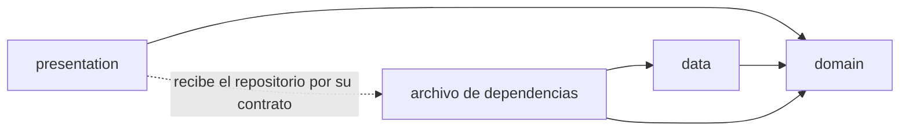
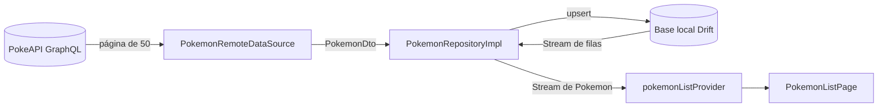
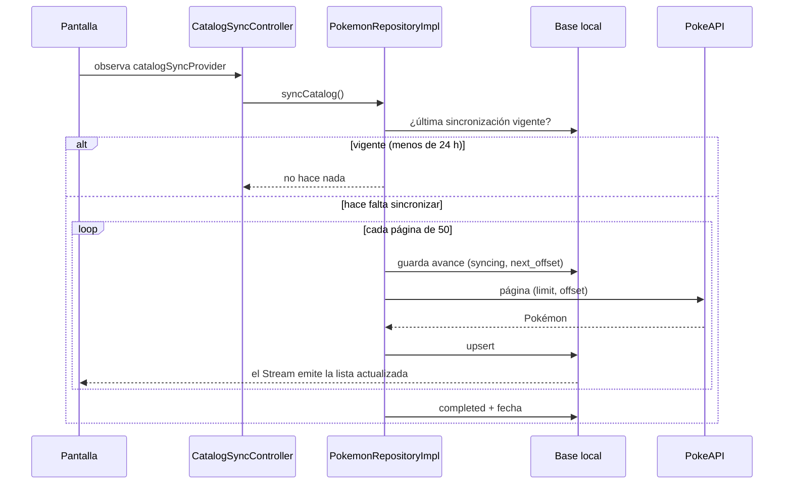

# Pokédex Flutter Offline-First

Proyecto final de **Desarrollo de Aplicaciones Móviles** (PUCMM): una Pokédex
hecha con Flutter que obtiene el catálogo de la API GraphQL de
[PokeAPI](https://pokeapi.co/docs/graphql), lo guarda en una base de datos
local y sigue funcionando sin conexión.

Este documento describe el **avance del proyecto**: estructura, persistencia,
integración con GraphQL y funcionamiento offline.


## Cómo ejecutar

Requisitos: **Flutter 3.44** (Dart 3.12) y un emulador o dispositivo Android o
iOS.

```bash
flutter pub get
```

```bash
flutter run
```


## Arquitectura

### Organización por funcionalidades

Cada funcionalidad (*feature*) tiene su propia carpeta con las tres capas. Lo
que comparten todas vive en `core`.

```
lib/
├── main.dart                      Punto de entrada
├── app/
│   └── app.dart                   MaterialApp, tema e indicador global
├── core/                          Compartido por todas las funcionalidades
│   ├── database/                  Base local (Drift): tablas y provider
│   ├── error/                     Errores tipados (Failure)
│   └── network/                   Cliente GraphQL
└── features/
    ├── pokemon/                   Catálogo de Pokémon
    │   ├── pokemon_dependencies.dart   Inyección de dependencias
    │   ├── domain/
    │   │   ├── entities/               Pokemon
    │   │   └── repositories/           PokemonRepository (contrato)
    │   ├── data/
    │   │   ├── local/                  Acceso a Drift
    │   │   ├── remote/                 Consulta GraphQL, DTO y acceso a PokeAPI
    │   │   ├── mappers/                Conversión DTO ↔ fila ↔ entidad
    │   │   ├── sync/                   Evita sincronizaciones simultáneas
    │   │   └── repositories/           PokemonRepositoryImpl
    │   └── presentation/
    │       ├── providers/              Estado de la pantalla (Riverpod)
    │       ├── pages/                  Pantalla del catálogo
    │       └── widgets/                Fila, imagen, etiqueta de tipo, mensajes
    └── connectivity/              Indicador Online / Offline
        ├── connectivity_dependencies.dart
        ├── domain/                     ConnectivityStatus y contrato
        ├── data/                       Implementación con connectivity_plus
        └── presentation/               Provider y widget del indicador
```

### Las tres capas

| Capa | Responsabilidad | Puede depender de |
|---|---|---|
| `domain` | Entidades y contratos de los repositorios. Dart puro. | Nada |
| `data` | Implementa los contratos: base local, API remota, DTO y mappers. | `domain`, `core` |
| `presentation` | Widgets y estado de la pantalla. | `domain`, `core` |



- `presentation` **no importa** nada de `data`, ni de GraphQL, ni de Drift.
  Recibe el repositorio por su contrato (`PokemonRepository`).
- El archivo `*_dependencies.dart` de cada funcionalidad es el único que conoce
  las clases concretas de `data`: crea la implementación y la entrega como
  contrato mediante un provider de Riverpod.
- Estas reglas se comprueban automáticamente en
  [`test/architecture_test.dart`](test/architecture_test.dart).

### Flujo de datos

La interfaz nunca recibe la respuesta de la red. La red escribe en la base
local y la interfaz observa la base:



La pantalla observa dos providers distintos:

| Provider | Qué contiene | Para qué lo usa la pantalla |
|---|---|---|
| `pokemonListProvider` | Los Pokémon guardados en la base local | Pintar la lista |
| `catalogSyncProvider` | El estado de la sincronización (en curso, error, terminada) | Barra de progreso, mensaje de error y «Reintentar» |

### Tecnologías

| Paquete | Uso |
|---|---|
| `drift` + `drift_flutter` | Base de datos local SQLite con consultas reactivas |
| `flutter_riverpod` | Manejo de estado e inyección de dependencias |
| `graphql` | Cliente GraphQL para PokeAPI |
| `connectivity_plus` | Estado de la red del dispositivo |
| `cached_network_image` | Imágenes con caché en disco |

## Modelo de datos local

Base SQLite (`pokedex.sqlite`) definida con Drift en
[`lib/core/database/`](lib/core/database).

| Tabla | Columnas | Llave primaria | Uso |
|---|---|---|---|
| `pokemon_table` | `id`, `dex_number`, `name`, `types`, `image_url`, `updated_at` | `id` | Catálogo descargado |
| `favorite_table` | `pokemon_id`, `created_at` | `pokemon_id` | Favoritos del usuario |
| `sync_metadata_table` | `resource_key`, `status`, `next_offset`, `last_success_at` | `resource_key` | Estado de cada sincronización |

- **Sin duplicados:** el `id` de PokeAPI es la llave primaria y se guarda con
  *upsert* (`insertAllOnConflictUpdate`): si el Pokémon ya existe, se actualiza.
- `types` guarda los tipos en orden, separados por coma (`grass,poison`).
- `status` es el enum `SyncStatus` (`syncing`, `completed`, `failed`).

## Estrategia de sincronización

Resumen de la estrategia elegida (el detalle y las alternativas están en el
[ADR 0002](docs/adr/0002-estrategia-de-sincronizacion-del-catalogo.md)):

1. **La base local manda.** La interfaz siempre muestra lo que hay guardado.
2. **Descarga completa y paginada.** Se pide el catálogo en páginas de 50
   (`limit` / `offset`) y cada página se guarda en cuanto llega, así la lista
   crece mientras se descarga.
3. **Solo cuando hace falta.** Al abrir la app se sincroniza si nunca se
   completó una descarga o si la última tiene más de 24 horas. El usuario puede
   forzarla con «Reintentar» o deslizando la lista hacia abajo.
4. **Reanudable.** Antes de cada página se guarda el avance (`next_offset`). Si
   la descarga se corta, el siguiente intento continúa donde se quedó.
5. **Los errores no borran datos.** Si falla, se registra `failed`, lo ya
   guardado se conserva y se muestra el mensaje con «Reintentar».
6. **Una a la vez.** `SyncCoordinator` evita dos descargas simultáneas.




Cómo comprobarlo a mano:

1. Abrir la app con conexión y esperar a que termine la barra de progreso.
2. Activar el modo avión: la lista sigue visible y el indicador pasa a
   «Sin conexión».
3. Cerrar la app por completo y abrirla de nuevo, todavía sin conexión: el
   catálogo aparece igual.


## Pendiente para la entrega final

- Pantalla de detalle completo.
- Favoritos (la tabla ya existe; falta la funcionalidad).
- Búsqueda y filtros.
- Trivia.
- Restauración de datos alterados.
- Reintentos automáticos con *backoff*.
- Estados «Servicio no disponible» y «Sincronizando» en el indicador.
- Funcionalidades complementarias y accesibilidad.
